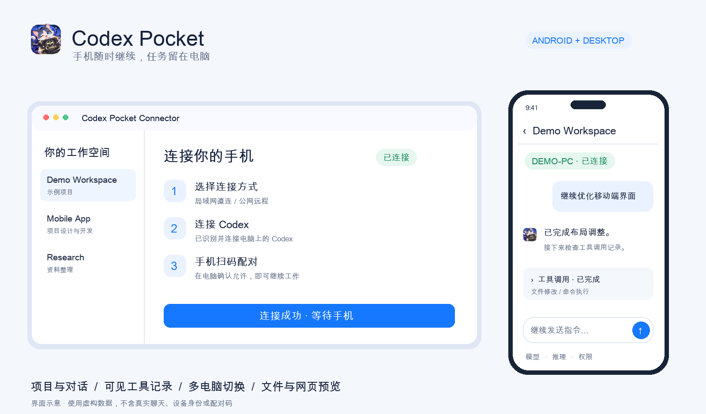
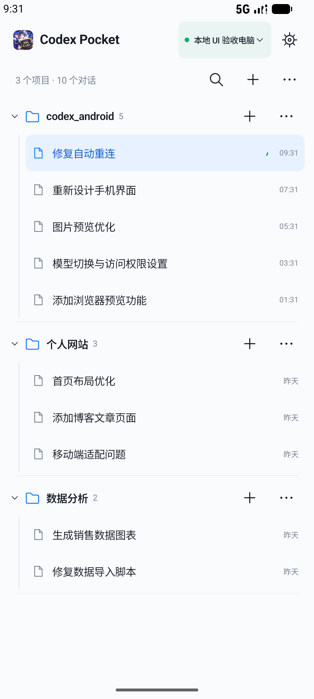
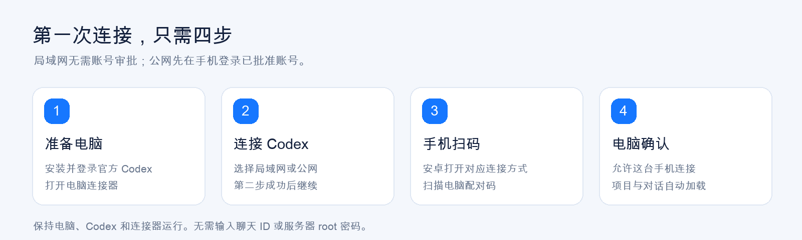
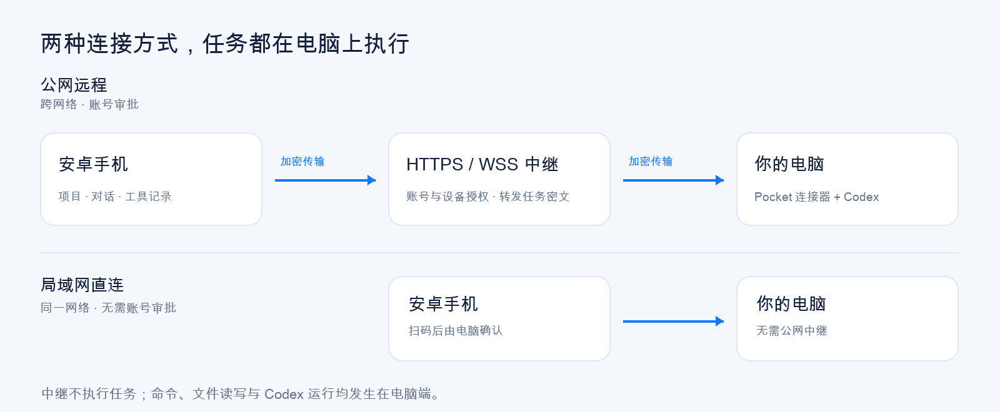

<p align="center"></p>
<h1 align="center">Codex Pocket</h1>
<p align="center"><strong>把电脑上的 Codex，装进口袋。</strong></p>
<p align="center">在安卓手机上查看项目、继续对话、处理审批，让任务在你自己的电脑上执行。</p>
<p align="center">
<a href="https://github.com/a110q/Codex-Pocket-Connector/releases/latest"></a>
<a href="LICENSE"></a>


</p>
<p align="center"><a href="#下载安装">下载安装</a> · <a href="#第一次使用">第一次使用</a> · <a href="docs/USER_GUIDE.md">使用手册</a> · <a href="docs/SELF_HOSTING.md">自建中继</a> · <a href="docs/DEVELOPMENT.md">源码构建</a></p>



> 独立社区项目，与 OpenAI 无隶属关系。需要先安装并登录官方 Codex 桌面应用。概览配图使用虚构项目和对话绘制；自建设置截图来自隔离测试环境，均不包含真实账号、二维码或生产服务地址。

## 能做什么

| 在手机上 | 支持的操作 |
| --- | --- |
| 项目与对话 | 查看本地项目及其对话，搜索、新建、继续聊天，长按归档、恢复或删除 |
| 完整过程 | 问答、可见思考摘要、命令、文件修改及工具调用；历史分页、长内容详情 |
| 模型与权限 | 切换可用模型、推理强度、权限模式，处理受支持的审批和提问，停止任务 |
| 图片发送 | 多选图片，搭配文字在同一条消息中发送，支持预览、移除与加密分片传输 |
| 自建中继 | 电脑配置地址与公开证书，手机扫码切换服务，无需重新构建客户端 |
| 文件与网页 | 图片缩放、文本和代码预览、PDF 分页、文件下载，以及电脑本地网页预览 |
| 多台电脑 | 保存多个配对并切换，按电脑隔离聊天缓存与草稿 |
| 账号管理 | 一个 APK 按角色展示菜单；管理员审批、停用、续期、管理设备和查看安全提醒 |

<p align="center"></p>

## 下载安装

**安卓与电脑连接器：0.7.8。** 从 [GitHub Releases](https://github.com/a110q/Codex-Pocket-Connector/releases/latest) 下载，每个 Release 仅存放其对应版本的安装包，校验值见同版 `SHA256SUMS.txt`。

| 平台 | 下载 | 使用方式 |
| --- | --- | --- |
| Android 10+ | [APK](https://github.com/a110q/Codex-Pocket-Connector/releases/download/v0.7.8/Codex-Pocket-0.7.8.apk) | 安装或覆盖更新；管理员和普通用户使用同一个包 |
| Windows 11 x64 | [EXE](https://github.com/a110q/Codex-Pocket-Connector/releases/download/v0.7.8/Codex-Pocket-Connector-0.7.8-Windows.exe) · [ZIP](https://github.com/a110q/Codex-Pocket-Connector/releases/download/v0.7.8/Codex-Pocket-Connector-0.7.8-Windows.zip) | 直接运行 EXE；需要 WebView2 Runtime |
| macOS 13+ | [Mac APP 压缩包](https://github.com/a110q/Codex-Pocket-Connector/releases/download/v0.7.8/Codex-Pocket-Connector-0.7.8-macOS.zip) | 解压得到 `.app`，移入「应用程序」后打开；支持 Apple Silicon / Intel |

Mac 包尚未 Apple 公证，Windows EXE 尚未代码签名。请核对下载来源；如系统拦截，可使用系统提供的「仍要打开」或「更多信息」入口。Windows 版本仍需更多实机反馈。

## 第一次使用



1. **准备电脑。** 安装并登录 [官方 Codex](https://chatgpt.com/codex)，再打开 Codex Pocket 电脑连接器。
2. **连接 Codex。** 选择「局域网」或「公网」，点击连接。自动识别失败时，在第二步手动选择 Codex 安装位置。连接成功后才能进入第三步。
3. **手机扫码。** 局域网点「局域网直连 · 无需账号审批」；默认公网先登录已批准账号。自建中继可从登录页直接扫码，确认切换服务后登录该服务账号。
4. **电脑确认。** 在电脑允许这台手机。项目与对话加载后，即可从手机继续工作。

电脑端不需要填写聊天 ID，也不需要服务器 root 密码。使用期间保持电脑、Codex 和连接器运行。

### 局域网还是公网？

| | 局域网直连 | 公网远程 |
| --- | --- | --- |
| 场景 | 手机和电脑在同一 Wi-Fi / 局域网 | 手机流量、外出 Wi-Fi 等跨网络场景 |
| 公网中继 | 不需要 | 需要 |
| 账号审批 | 不需要 | 注册申请，由中继管理员批准 |
| 配对 | 手机扫码，电脑确认 | 手机扫码，电脑确认 |
| 地址 | 电脑私有 IPv4 地址 | 配置的 HTTPS 公网服务 |

**本仓库 Release 安装包预设维护者的公网服务。** 注册不等于批准，是否开放由管理员决定。仓库不提供默认管理员账号或密码。公开源码的部署配置以 `XX` 为示例，不包含维护者的实际配置。自建服务请看 [自建中继](docs/SELF_HOSTING.md)，电脑配置后手机扫码即可连接，无需重新构建客户端。

## 如何连接



手机提供操作界面，电脑连接器对接已安装 Codex 的 App Server 和桌面 IPC。任务、命令与文件操作在电脑执行。公网模式通过中继传输加密消息，局域网模式直接连接电脑。详细操作见 [使用手册](docs/USER_GUIDE.md)。

## 隐私与功能边界

- 使用 HTTPS / WSS、证书固定和 AES-256-GCM。中继可以看到账号、设备和连接元数据；任务内容按配对密钥加密传输。
- 手机配对与缓存加密保存。安装包包含公开连接配置，不包含服务器 root 密码、SSH 私钥、管理员密码或其他用户配对数据。
- 混淆和完整性检测增加篡改成本，无法保证禁止反编译或发现离线分析。
- 只同步可见事件与摘要，不读取隐藏推理。当前覆盖本机 Codex 项目与聊天；远程主机、ChatGPT Work 全量目录、完整终端、通用文件上传和部分高级审批尚未覆盖（已支持图片上传）。
- 网页预览不共享电脑浏览器 Cookie、标签或扩展。文件下载上限 100 MB，预览上限 50 MB，文本预览上限 512 KB。
- 断网后不自动重发结果不确定的操作。先恢复连接并核对任务，再决定是否重发。

**0.7.8** 调整手机首页密度：搜索按需展开、新建入口移至顶部、精简项目和对话间距。补齐手机任务的桌面跟随同步，避免电脑再次获取同一会话的写入锁；加强空闲释放检查。电脑和手机都需更新。详见 [更新说明](docs/patch-0.7.8.md) 与 [验收记录](docs/verification-0.7.8.md)。Windows 11 仍待实机验收。

## 开发与自建

```sh
git clone https://github.com/a110q/Codex-Pocket-Connector.git
cd Codex-Pocket-Connector
npm ci
npm test
```

- [源码构建与项目目录](docs/DEVELOPMENT.md)：三端构建、自有签名与测试。
- [自建 HTTPS 中继](docs/SELF_HOSTING.md)：证书、环境变量、管理员初始化和客户端配置。
- [安全反馈](SECURITY.md)：反馈前移除密码、Token、完整二维码和个人对话。

## 反馈与贡献

欢迎通过 [Issues](https://github.com/a110q/Codex-Pocket-Connector/issues) 反馈。请注明版本、手机与电脑系统、连接方式、复现步骤，并提供脱敏截图或日志。提交前运行相关测试；界面改动建议附上使用虚构数据的截图。

## 许可证

沿用 [MIT License](LICENSE)。第三方组件遵循各自许可证，见 [第三方说明](THIRD_PARTY_NOTICES.md)。品牌图由维护者提供，不代表 OpenAI 官方产品。
