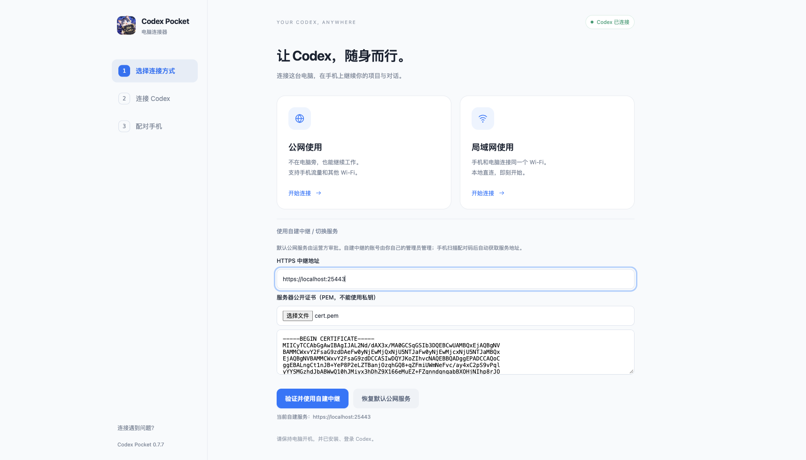

# 自建公网中继

局域网直连不需要公网服务器。本节适用于希望使用自己的服务器提供跨网络连接、账号审批与设备管理的维护者。示例中的地址、密码或凭据占位均为 `XX`，必须自行配置。

## 1. 准备环境和证书

准备可访问的服务器、Docker / Compose、Node.js >=22.13，以及与服务域名或 IP 匹配的 TLS 证书。客户端固定证书指纹，同时校验主机名；证书 SAN 必须匹配连接地址。中继默认对外使用 TCP 24443，可自行调整。

```sh
git clone https://github.com/a110q/Codex-Pocket-Connector.git
cd Codex-Pocket-Connector
npm ci
mkdir -p .private/relay-data .private/relay-certs
```

将自己的证书和私钥分别保存为 `.private/relay-certs/cert.pem` 与 `.private/relay-certs/key.pem`。不要提交或分发私钥。自签证书可供固定证书的客户端使用，但仍需要正确 SAN、有效期和安全保存的私钥。

## 2. 生成管理令牌

管理令牌是中继管理 API 的凭据，和服务器 root 密码无关。

```sh
node -e "process.stdout.write(require('crypto').randomBytes(32).toString('base64url'))" > .private/relay-admin.txt
chmod 600 .private/relay-admin.txt
cp config/relay.env.example .private/relay.env
```

在本地私密的 `.private/relay.env` 中，把 `RELAY_ADMIN_TOKEN=XX` 换成刚生成的令牌。`RELAY_ANDROID_CERT_SHA256` 是自己 APK 签名证书的 SHA-256 指纹；首次开发时可设为空，启用签名校验时填写真实指纹。不要将 `XX` 保留到正式配置，也不要公开这些文件。

## 3. 启动中继

`deploy/compose.example.yaml` 把数据和证书挂载在 `.private/`，不包含维护者服务器路径或登录信息。Linux 上让容器的 UID 1000 能读证书和写数据：

```sh
sudo chown -R 1000:1000 .private/relay-data .private/relay-certs
sudo chmod 700 .private/relay-data .private/relay-certs
sudo chmod 600 .private/relay-certs/key.pem
docker compose -f deploy/compose.example.yaml up -d --build
docker compose -f deploy/compose.example.yaml logs --tail=30
```

在云安全组和主机防火墙放行自己使用的 TCP 端口。健康检查是 `https://XX:24443/healthz`；自签证书时使用 `curl --cacert <公开证书路径>` 验证，不建议关闭证书校验。不要只凭端口可达认定认证或配对已正常工作。

## 4. 创建自建服务的管理员

在构建电脑上运行：

```sh
node scripts/configure-server.mjs --relay https://XX:24443 --cert /absolute/path/to/cert.pem
```

配置脚本只写地址、公开证书及指纹，不会复制管理令牌或任何配对身份。然后使用管理令牌初始化首个管理员：

```sh
node scripts/account-admin.mjs bootstrap \
  --config .private/client-defaults.json \
  --admin-file .private/relay-admin.txt \
  --username pocket_admin \
  --out .private/administrator.json
```

管理员随机密码写入 `.private/administrator.json`，不会打印到终端。仅在私下读取并保管，不要放进 Release 或仓库。仓库没有通用管理员密码。已经初始化的服务不要重复重置或替换管理员数据。

## 5. 电脑配置，手机扫码（0.7.7 起无需重编译）

1. 使用 0.7.7 电脑连接器，在第一步展开「使用自建中继 / 切换服务」。
2. 填入你的 HTTPS 地址，导入公开的 `cert.pem`，点击「验证并使用自建中继」。连接器验证证书、主机名、健康检查协议和账号接口；验证失败不会切换服务。
3. 连接 Codex，成功后显示二维码。默认公网服务的电脑身份会保留，自建服务使用独立身份与配对。
4. 手机安装 0.7.7 APK。从登录页点「扫描电脑配对码 / 连接自建中继」，核对地址与证书指纹并确认切换。
5. 用第 4 步创建的管理员登录；普通用户可在此服务注册，由自己的管理员批准。手机不会使用默认公网服务的 Token 登录自建服务。
6. 手机开始显示「配对中，等待电脑确认」。在电脑上允许连接后，可查看项目和对话、发文字与图片。



管理员与普通用户用同一个 APK，权限菜单由自建服务器返回的角色决定。对已有账号停用、到期、审批和设备额度的检查继续有效；自建不意味着绕过自建管理员的授权。

仅当你想更改安装包的**默认**服务、品牌或签名时，才需要按 [源码构建](DEVELOPMENT.md) 重新打包。脚本 `configure-server.mjs` 会生成默认客户端配置，不能把它生成的私密文件提交到仓库。

更换证书时，在电脑重新导入新的公开证书，手机重扫新配对码并确认指纹。不同地址或不同证书按独立服务保存，原绑定仍保留；如电脑额度已满，由自建管理员移除旧绑定。

## 部署验收

请依次验证 `/healthz`、管理员登录、普通用户申请与审批、电脑连接、手机扫码与确认、文字和图片、断线恢复及重启后数据。0.7.7 已在隔离 Docker 中继和安卓模拟器走通这些流程，见 [验收记录](verification-0.7.7.md)。自己的公网域名、证书和安全组仍需按实际环境检查。

## 数据与升级

中继保存账号、设备、授权、事件和连接路由；任务内容使用配对密钥加密。请备份 `.private/relay-data`、证书私钥、管理令牌及自有 APK 签名密钥。SQLite 备份应使用一致性备份方式或在停服后复制，不要直接复制仍在写入的主文件而忽略 WAL。

升级前备份并验证回滚方法，再替换容器；不应清空数据库来解决连接问题。本仓库不提供任何个人生产服务器的 SSH 登录信息或专用升级脚本。
