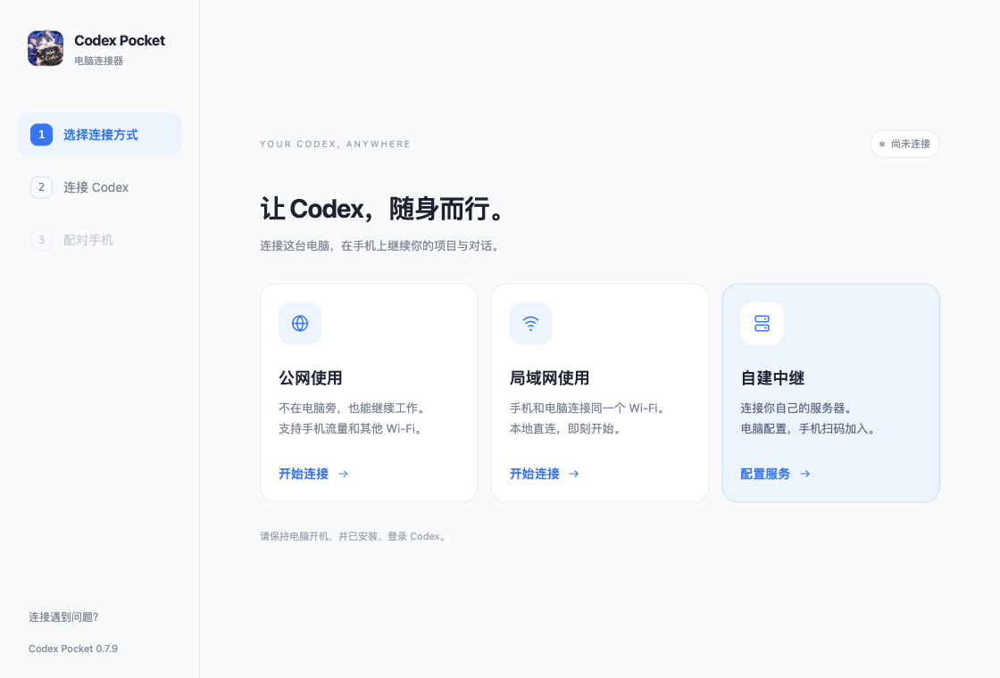
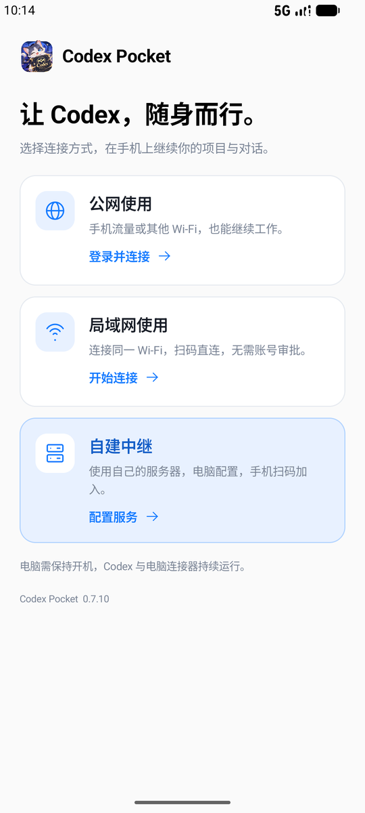
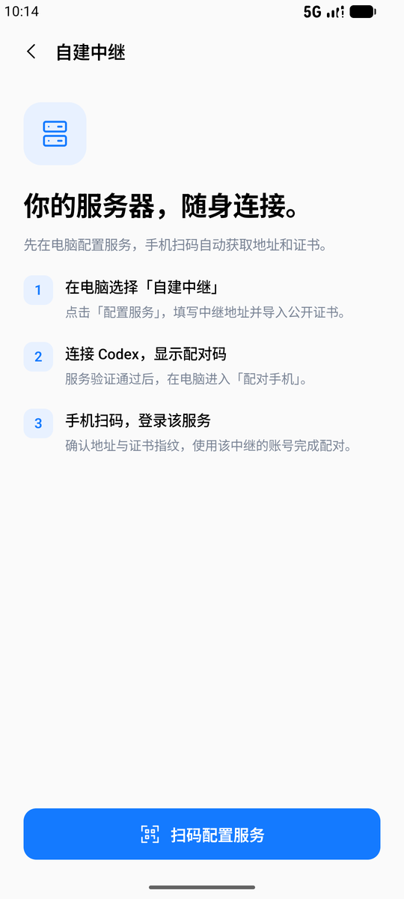
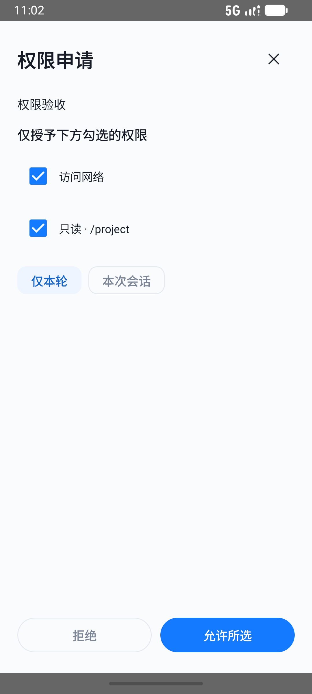
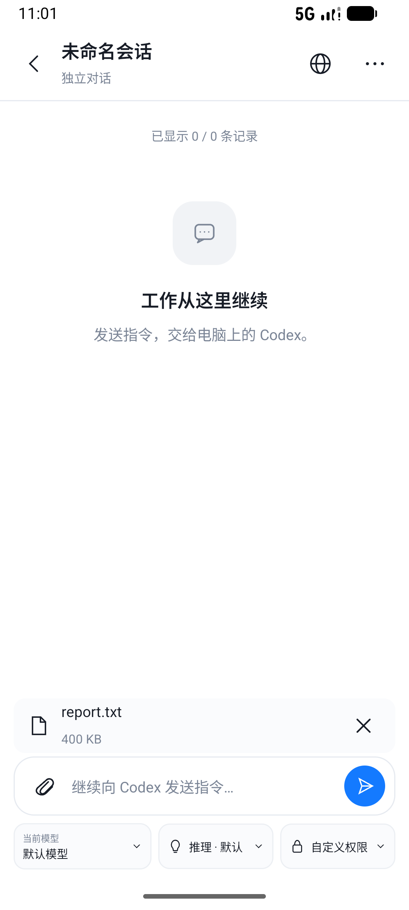
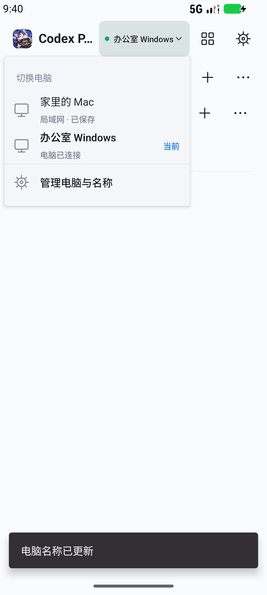

# 使用手册

## 安装与首次连接

从 GitHub Releases 下载相应平台的最新版本（电脑与安卓均为 0.9.5）。电脑先安装并登录官方 Codex。Windows 直接运行 EXE，或完整解压 ZIP 后运行 `Codex-Pocket.exe`；Mac 解压得到 `.app` 并移入「应用程序」。安卓安装 APK，更新时用同签名新版覆盖安装，不必先卸载。

电脑选择连接方式，点击「连接 Codex」。识别失败时手动选择程序或安装目录。第二步成功后进入第三步显示二维码，手机扫码后在电脑确认允许。

**局域网：** 手机和电脑接入同一网络，电脑选局域网，手机首页选择「局域网使用」，查看指引后点击「扫码连接电脑」。无需登录，但仍需电脑确认。只接受私有 IPv4 地址；若连接失败，检查防火墙和 Wi-Fi 客户端隔离。公网与局域网分别保存配对。

**公网：** 电脑选公网。手机首页点击「公网使用」，在独立登录页注册并申请，管理员批准后登录，再扫码并由电脑确认。电脑不需要登录 Pocket 账号或输入 SSH 信息。两端均需能访问同一中继，电脑不能休眠。

## 手机连接首页

首次使用时，先选择「公网使用」「局域网使用」或「自建中继」。三种方式各有独立页面，顶部返回按钮和系统返回键都可以回到选择页。扫码取消后保留当前指引；已经配对的电脑在下次打开时自动进入工作空间。

## 自建中继

电脑第一步点击蓝色「自建中继」卡片的「配置服务」，填写服务的 HTTPS 地址，选择或粘贴公开 TLS 证书，再点击「验证并使用自建中继」。这里不需要服务器 root 密码、SSH 信息或中继管理令牌。

手机首页点击「自建中继」，查看电脑配置指引后点击「扫码配置服务」。已连接的用户可从「设置 → 选择连接方式」回到三个卡片。确认服务地址与指纹后，登录或申请该服务的账号。审批由这台自建中继的管理员负责，与默认公网服务的审批相互独立。登录通过后沿用扫码结果开始配对；电脑允许后自动进入工作空间。二维码过期时在电脑更新后重扫。

手机可返回连接首页点击「公网使用」，电脑可点击「恢复默认公网服务」。不同服务各自保留账号和配对；不会把原服务 Token 发给其他服务器。详细部署见 [自建说明](SELF_HOSTING.md)。

 

## 项目和对话

首页按项目展示对话，可搜索、展开、收起。点击对话可继续聊天，查看工具调用及状态；更早历史可继续加载，长工具结果可展开详情分段读取。顶部「＋」创建独立聊天，项目右侧「＋」可沿用项目。搜索可按需展开，已归档、任务动态与刷新可在更多菜单中找到。

手机新建的对话会刷新进入电脑侧栏。手机发起的一轮回复完成后会自动释放会话，电脑可继续输入；电脑继续后手机优先跟随同一条对话。运行中保留一个写入者。

长按对话可以归档、恢复或删除；删除需再次确认，运行中的任务需先停止。已归档对话可从「已归档」入口查看和恢复。停止按钮用于中断当前轮次。

手机与电脑均为 0.9.2 时，切后台或断线重连后会自动查询上次操作的确认记录。电脑已收到但仍在处理时显示等待结果，找不到记录时提示先检查会话。核对完成前不会自动重发；确实未执行时，点待确认提示的「查看」，检查后选择「已查看，清除记录」并再次确认，再重新发送。旧电脑版本仍需手动确认。

## 模型、推理和权限

聊天输入区下方可以选择电脑提供的模型、推理强度和权限模式。设置写入后会重读确认，应用到后续消息；可选项取决于电脑上的 Codex 和账号权限。

命令执行、文件修改审批和问题回答可在手机处理。目录/网络权限申请点击「查看并处理」，逐项勾选，可选择「仅本轮」或「本次会话」。

常见 MCP 表单支持文本、数字、开关、单选和多选。URL 授权可打开浏览器完成后返回确认。复杂表单和需电脑完成的身份验证会提示在电脑处理；不会自动接受。手机授予的权限和发出的指令会在电脑上生效。

## 图片、文件和网页

输入框左边的附件按钮展开「添加图片」「添加文件」。图片最多 4 张，可点击缩略图上的 × 移除。输入文字后点击发送，文字与所有图片进入同一条消息；也可只发图片。新建对话也有「添加图片」入口。原图最多 50 MB，手机会按最长边 2048 像素处理并移除元数据，单张处理后最多 10 MB。

普通文件每条最多 4 个、单个最多 50 MB，可选文档、代码、压缩包等。可与文字、图片一起发送，也可只发文件；新建对话支持同样的操作。文件卡片的 × 可移除；普通文件保持原始内容。旧电脑连接器不会显示可用的文件上传选项，请两端都升级到最新版本。

发送失败会保留草稿或待确认记录。上传未完成不会发出文字。上传到电脑的附件保存在该电脑的连接器私有数据目录，用于后续聊天和图片回显。

「交付与修改」仍在对话右上角「更多 → 查看交付文件」中。

点击图片可以缩放预览。当前对话可访问的文件支持文本、代码、图片和 PDF 预览，部分文件可下载。

网页入口可访问电脑上的开发服务器。它通过电脑侧代理通道打开网页，不是远程桌面，也不复制电脑浏览器登录状态；需要登录的网站可能要在预览内重新登录。小窗支持收起、展开和关闭。

## 后台任务提醒

进入「设置 → 后台任务提醒」开启并允许通知。通知栏会出现常驻连接状态，任务完成、出错、等待审批时提醒；点击提醒回到对应电脑和对话。可以从设置关闭，也可点击常驻通知中的「关闭提醒」。

提醒覆盖当前连接方式与当前中继下已批准配对的电脑。切换到局域网时监视保存的局域网电脑；公网时仍会核对当前服务账号与设备权限。App 在前台时优先直接展示任务，回到后台后接管连接；不会自动发送消息或接受审批。

电脑、Codex、连接器与网络需要保持运行。提醒使用安卓前台服务，不依赖 Google Play；部分手机需额外允许后台运行。强行停止 App、系统回收/限制网络或电脑睡眠期间无法保证及时提醒；重新打开 App 后恢复。不开启此功能时不会保留这条后台任务连接。它不替代管理员账号申请提醒。

聊天页的连接与错误提示合并为一行，点击「详情」展开。待确认操作通过「查看」核对和处理，仍保留二次清除确认。断线时不再根据旧快照显示“Codex 正在处理”，可以继续写草稿，恢复连接并核对上一条操作后再发送。

## 添加和切换电脑

点击顶部电脑名称旁的下拉箭头，直接选择已配对电脑；当前电脑会标注「当前」。下拉底部的「管理电脑与名称」进入管理页，也可从「设置 → 我的电脑」进入。扫描另一台电脑的配对码并确认后，就会出现在列表中。

管理页点击名称旁的铅笔，或电脑行的「⋯ → 重命名」，可设置“办公室 Windows”“家里的 Mac”等名称。名称保存在本手机，重新扫码同一台电脑仍保留，不修改电脑系统名。

各台电脑的项目、对话缓存、草稿、附件与待确认操作分别保存。发送结果暂未确认时也可切换，回到原电脑后继续查询结果；不会自动重发。附件仍在准备时需先等待完成。移除电脑前需核对待确认操作。

公网账号默认五台电脑、一部手机；管理员可把电脑额度调整为 1–50 台。更换手机遇到设备限制时，请联系管理员移除旧设备。

### 把电脑改绑到另一个账号

管理员先从旧账号移除目标电脑，再在这台电脑使用 **0.9.2 或更新版本**的连接器，点击「公网使用」或「连接 Codex」。连接器会重新准备身份并生成新的二维码。在手机登录接收电脑的账号、扫码，然后在电脑点击「允许连接」。旧账号的配对凭据继续失效，Codex 原有项目和对话不受影响。

若旧版显示 `Unauthorized`，完全退出旧连接器后更新电脑端即可；本次三端统一 0.9.2，中继无需升级。账号停用或到期仍需管理员处理，不会自动改绑。

## 管理员

同一个 APK 根据账号展示菜单。管理员登录后可从设置进入管理中心和用户中心，批准或拒绝申请、创建账号、停用或恢复、续期、管理设备、调整电脑额度并处理安全提醒。

没有默认管理员密码。自建服务的首个管理员通过服务端管理令牌初始化，随机密码只写入指定私密文件，见 [自建说明](SELF_HOSTING.md)。

## 常见问题

| 问题 | 处理方式 |
| --- | --- |
| 登录后仍需批准 | 注册只表示创建账号，需管理员批准且未到期、未停用 |
| 第三步不能点击 | 先完成第二步，确认 Codex 已登录、路径正确且连接成功 |
| 断网或睡眠后掉线 | 恢复电脑网络并唤醒，保持连接器运行；手机会等待恢复，也可点「重连」。断线提示点「详情」查看具体状态 |
| 连接已由另一处接管 | 同一电脑身份出现重复连接实例；关闭重复实例，再在要使用的一端手动连接。0.9.4 起旧实例不会自动抢回连接 |
| 账号或设备权限已失效 | 检查账号是否获批、到期或被停用，恢复授权后手动重连；这类错误不会无限自动重试 |
| Windows 端口占用 | 新版回收自己启动的进程；首次升级前退出旧版，必要时重启电脑 |
| `was cancelled` 或重复气泡 | 更新 0.7.8；自动重读旧快照，保留配对、草稿和待确认操作 |
| 已在另一个应用中打开 | 电脑连接器更新至 0.7.8，新版支持电脑跟随手机运行中的会话；升级前留下的提示可点击一次「重试」；无需创建聊天分叉 |
| 手机提示 active writer | 更新电脑连接器至 0.7.8；会自动恢复桌面连接并跟随当前会话。旧黄色提示点一次「重新确认」，未发送消息回填到草稿后再发送 |
| 删除后电脑仍有入口 | 更新电脑连接器至 0.7.8；新删除会同时刷新桌面侧栏，电脑正在持有该会话时需先关闭其页面 |
| 扫码后等待电脑确认 | 在电脑连接器点击「允许连接」；临时断网会自动继续等待，可点「取消配对」返回 |
| 发送超时但电脑已有消息 | 点「重新确认」，新版按请求标识核对，不会重发。旧版模糊超时请先人工核对 |
| 想退出扫码 | 点击 X 或系统返回键 |
| 与电脑全部功能一致吗 | 目前支持常用项目、聊天、工具记录、设置和预览，完整终端等尚未覆盖 |

反馈时不要附上完整二维码、密码、Token 或真实个人对话。

### 紧凑工作空间

首页顶部的放大镜可展开搜索，输入时仍保留正常输入框高度；点 ＋ 创建独立对话，项目右侧的 ＋ 在该项目下创建。右上方「⋯」可进入任务动态、已归档和刷新。项目标题显示对话数，点击可折叠。

## 工作空间工具（0.9.0）

工作空间右上角的四格工具按钮打开工具目录；聊天「更多 → 工作空间工具」同样可打开。聊天顶部的文件按钮直接进入当前目录。连接多台电脑时，所有操作作用于当前选中的电脑。

### 对话名称

在对话列表长按，选择「重命名对话」，或在聊天「更多」菜单操作。名称最多 60 字，保存后同步到电脑 Codex。

### 文件、附件与 @引用

在「项目文件」选择项目，进入目录或按名称搜索。点击文件可以预览图片、PDF、文本与代码；其他文档可保存后用合适的软件打开。搜索有结果上限，提示结果过多时请缩小范围。

聊天内点击文件旁的「@引用」，或在输入框输入 `@关键词` 选择建议，发送时将真实项目文件引用一同交给 Codex。引用草稿按电脑和对话保存，可以点击引用标签移除。手机本地 PDF、文档、代码和图片仍使用附件菜单上传。

### Git 与代码审查

「代码与 Git」展示真实分支、上游、修改文件和本地/远程分支列表。点击文件，分别查看未暂存或已暂存的红绿差异；左侧显示旧文件和新文件行号。

选择需要提交的文件，填写说明，在确认页核对分支与文件后执行。工作区自读取后发生变化，或暂存区存在其他未选文件时，会拒绝提交并要求重新检查。推送需要电脑已经为当前分支设置上游；不提供强推。

打开项目聊天后可以「发起审查」，选择未提交修改或一个基础分支。审查指令发送到当前聊天，要求报告问题及位置，不直接修改文件。普通文件夹、缺少 Git 或未选择仓库根目录时，页面会显示原因并隐藏无法执行的按钮。0.9.1 暂时移除手机「创建 PR」入口。

### 技能与插件

「技能」展示当前项目、用户与内置技能，可按名称或用途搜索，筛选已启用项。列表显示简短介绍，点击「查看详情」阅读正文；需要时再展开来源位置。创建技能时保留 `SKILL.md` 的 `name`、`description` 头部。只有用户自行创建的本地技能可编辑或删除；删除后保存在电脑的 `~/.codex/pocket-skill-backups`。编辑前若电脑已更改文件，需重新打开。

「插件」可切换已安装列表与市场，支持搜索及允许的安装、卸载和启停。安装前会显示来源并确认；账号/组织策略或官方安装告知要求电脑处理的插件不显示无效操作按钮。管理员管理的插件不提供卸载或启停。工具认证在「工具服务」查看：只有支持网页 OAuth 的服务提供授权按钮；「电脑管理」表示认证由桌面处理，无需在手机重复登录。

### Pocket 定时任务

在「定时任务」创建任务，选择执行项目、填写指令，并设置每天、工作日或每隔若干小时执行。可暂停、恢复、编辑、立即执行或删除；启动记录可打开对应聊天。

这是连接器自己的调度功能，与官方 Codex 定时任务独立。电脑需保持开机，Codex 与连接器持续运行。离线错过的任务不会补发；电脑重启时不会自动重放结果待确认的任务。历史中的「已发起」指消息成功提交，任务后续进度在对应聊天中查看。

### 会话统计

「会话统计」读取当前电脑 Codex 的实际数据，展示会话累计 Token、最近上下文与窗口大小；账号接口可用时显示真实额度与恢复时间。无法读取账号额度时隐藏该区块，没有会话统计则显示空状态；不会填充推算值。上下文比例使用最近一次 Token 统计，累计 Token 不等于上下文占用，也不等于账单。

### 多电脑通知

在设置开启「后台任务提醒」，并允许系统通知。手机查看某台电脑时，其他已配对电脑仍会提醒审批、任务完成与出错；当前电脑的其他对话复用已有连接检查。通知标注电脑和对话，点击后切换并打开对应对话；待确认操作按电脑保存；附件准备期间会提示先等待完成。

覆盖范围是已配对的局域网电脑与当前中继账号获准访问的电脑。切换到另一个中继账号后，不再监控原服务。电脑需开机且保持连接器运行；部分手机还需在系统设置允许后台运行。强行停止 App 后，需重新打开才能恢复提醒。

### 扩展审批

目录和网络请求可缩小授权范围，选择本轮或会话作用域；可要求本轮后续命令先自动审查。命令详情中只显示工具实际提供的命令前缀及网络规则候选。

标准 MCP 表单保留字段类型、选项值、显示标题与默认值；嵌套扩展表单可以按原始规则填写 JSON，电脑校验通过才提交。URL 请求先打开授权网页，再返回点击继续；MCP 登录以电脑的完成通知为准。OpenAI 专用身份验证及专用输入控件仍需在电脑完成，手机可查看、拒绝或取消，不会伪造验证结果。

## 网页链接与单台电脑移除（0.9.4）

点击对话里的网页链接可在 App 内展开访问；电脑本地项目仍经加密连接访问。点退出展开或系统返回键缩回小窗，点关闭回到对话。加载失败时点「重新打开网页」。

管理员在「用户中心」找到账号，再点具体电脑右侧的「移除」，核对名称后确认。管理员自己的电脑也支持此操作；其他电脑、手机登录和电脑上的任务不受影响。被移除的电脑再次使用需重新扫码配对。自建中继请同步更新到 0.9.4。

## 网页首次加载慢或白屏（0.9.5）

请同时更新手机 App 和电脑连接器。大型开发页面的脚本会在加密通道内压缩传输，不修改网页内容。加载时显示已接收数据量；仍有数据传入时不会在 30 秒强制停止。45 秒没有新数据，或单次加载达到 3 分钟时，会提示重新打开。刷新按钮会重新建立转发连接。

本次不要求升级中继。手机与旧连接器仍可兼容，但旧连接器不会压缩，需要更新电脑端才能获得完整改善。电脑、项目服务和连接器需要保持运行。
