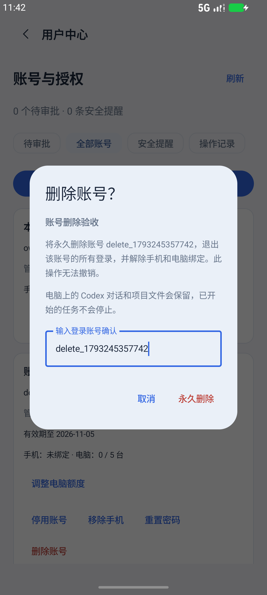

# 管理员删除账号

手机进入「设置 → 用户中心」，在普通用户卡片下点击红色「删除账号」。输入该用户的完整**登录账号**，再点击「永久删除」。输入不一致时无法确认，点击「取消」不会修改账号。超级管理员不显示删除入口，服务端也会拒绝删除管理员或当前登录账号。

删除会永久移除账号、密码、登录会话、绑定手机和设备使用权限。该账号所有已连接的电脑和手机会断开，旧设备凭据和旧配对码失效，尚未确认的配对申请会清除。其他账号不受影响。电脑本地的 Codex 对话、项目文件和正在执行的任务会保留；管理员操作记录也会保留。

删除后可以重新注册相同登录账号，但会生成新的账号身份，需要重新审批与配对，不会继承旧绑定。

此功能包含在 Android **0.9.8.1 / versionCode 30** 中，可覆盖安装。电脑连接器无需为此功能更新；中继必须使用包含该接口的新代码。自建中继更新源码并按原部署方式重新构建容器，保留原数据库、证书和环境配置。健康检查 `/healthz` 返回 `accountDeletion: "confirmed-v1"` 表示支持。

接口为 `POST /api/admin/users/delete`，使用已激活管理员的 Bearer Token，请求体包含 `userId` 和 `confirmUsername`，后者必须与目标账号完全一致。服务端在事务中清理凭据和绑定，提交成功后断开连接；清理失败时回滚全部修改。

验证覆盖账号确认、管理员保护、多电脑断连、其他用户保持连接、待确认配对清理、重启后失效、同名重新申请和写入失败回滚。手机确认框使用隔离服务验证。当前完整结果见 [0.9.8.1 验证记录](verification-0.9.8.1.md)。
