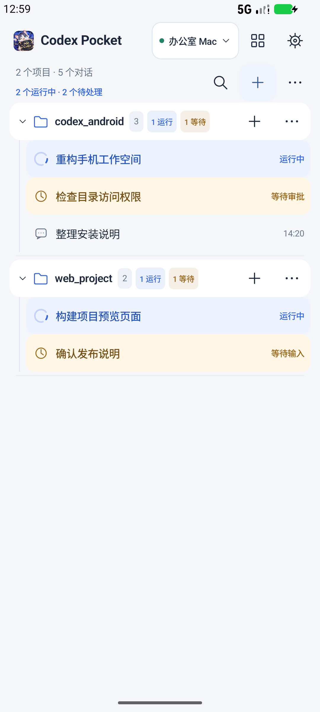

# 手机任务状态

Android 0.9.8.1（versionCode 30）在工作空间展示任务状态，并保留已确认的运行标记。

- 蓝色转圈和“运行中”：任务正在执行。
- 橙色时钟和“等待审批 / 等待输入”：需要你处理。
- 项目旁显示运行与等待数量，折叠项目后依然可见。
- 点击列表上方的活动数量，进入“任务动态”，集中查看运行中、等待处理及出错的对话。
- 完成后恢复普通对话图标。连接断开时显示“上次状态”，停止播放运行转圈。

前台每 5 秒查询一次对话摘要，已订阅对话的实时事件也会更新列表；无需开启通知。状态查询不会逐个读取聊天历史。后台暂停列表查询，返回后重新同步；电脑切换与归档筛选分别处理，旧响应不会覆盖新的实时状态。

## 运行标记提前消失的修复

内部版本 28 会把列表中的 `unknown` / `notLoaded` 当成新的运行状态，覆盖之前确认的“运行中”。这类摘要没有执行状态信息，不能据此判断任务已经结束。修复后保留本次桌面连接中已确认的运行状态，连续刷新或暂时没有新事件都不会自动取消标记。

明确的完成、报错、等待审批或等待输入仍会更新标记。运行状态和回合字段一起替换，完成后不会因旧 `activeTurnId` 再次显示运行。新建连接或电脑在原中继连接上重新上线后，重新获取状态，避免把缓存状态当成当前状态；如果此时摘要仍无运行信息，显示状态未知，直到收到明确状态。

任务状态由手机展示；本次版本还包含连接恢复修复，请同时更新手机 APK 和电脑连接器。连接恢复无需升级中继。

## 验证

2026-10-29 在 Android 模拟器增加运行状态保持和重连状态隔离的回归测试。旧代码可稳定复现：连续刷新后，任务从运行中退回状态未知。修复后连续一分钟、12 次摘要刷新且无新的运行事件，运行标记和项目数量仍然保留；随后等待审批、完成清除、后续未知摘要与连接重建均验证通过。

最终连接与任务状态 43 项模拟器回归全部通过；执行过程折叠及图片、文件、审批、网页布局等界面回归 25 项通过。21 项 JVM 测试、Android Lint、Release 签名校验、覆盖安装和冷启动检查通过。详见 [0.9.8.1 验证记录](verification-0.9.8.1.md)。

状态测试使用隔离的 TLS/WebSocket 服务，覆盖未打开对话的实时状态、通知关闭时自动刷新、后台暂停、重连、过期响应、流版本重置、归档筛选、电脑切换及审批/输入状态区分。截图使用虚构任务，不代表真实用户对话；本轮未在用户的实体安卓手机上验收。

